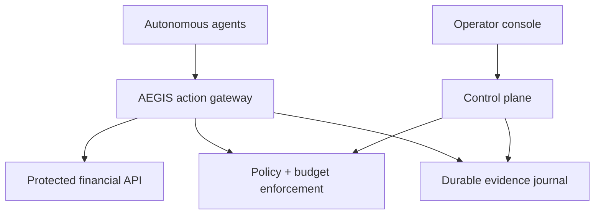
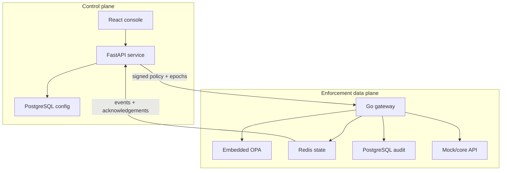
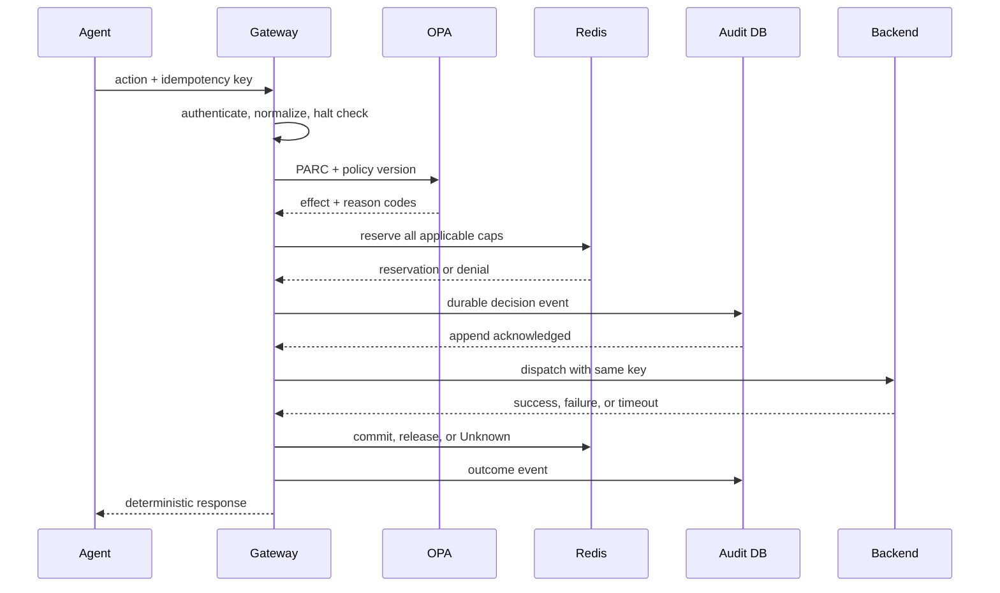
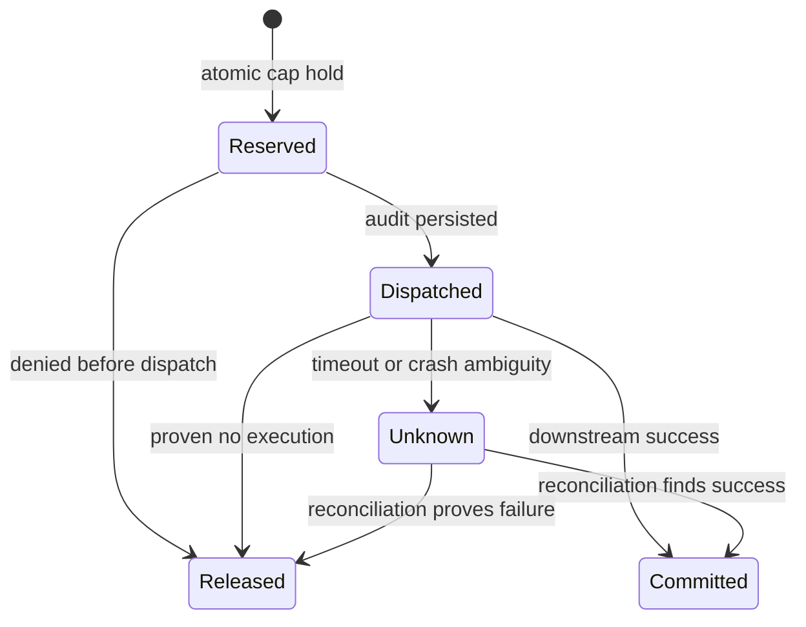
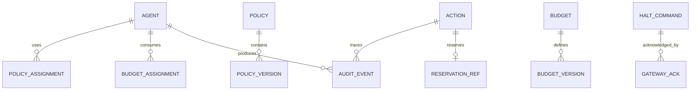
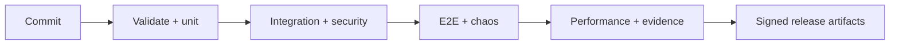

# AEGIS Software Requirements Specification

## Governance Layer for Financial Agents

Version 1.0 | 22 July 2026 | Implementation baseline

**Companion:** `AEGIS_PRD.md`

**Normative language:** “Shall” is mandatory, “should” is recommended, and “may” is optional. P0 requirements block MVP release. All benchmark thresholds marked **[A]** are targets requiring measurement on declared hardware.

## 1. Purpose

This SRS defines the implementable behavior, interfaces, data model, safety properties, failure semantics, and verification plan for AEGIS: an inline governance layer that controls autonomous financial-agent actions before execution.

The intended readers are product managers, frontend/backend/platform engineers, policy engineers, security and privacy reviewers, QA/SRE teams, auditors, and challenge judges.

## 2. Scope

AEGIS receives an action intent from an authenticated agent, converts it into a canonical Principal–Action–Resource–Context request, evaluates revocation and policy state, reserves applicable financial exposure atomically, writes durable decision evidence, and then either forwards the action to a protected backend or returns a deterministic denial/hold/failure response.

The MVP includes:

- a Go enforcement gateway with embedded OPA;
- OPA/Rego policy bundles and policy tests;
- Redis-backed budget reservations and revocation/halt epochs;
- PostgreSQL configuration and append-only audit evidence;
- a FastAPI control plane;
- a React operator console;
- a mock protected financial API;
- a Python agent/adversary simulator;
- correctness, concurrency, chaos, audit, and latency test harnesses.

The MVP excludes live money movement, legal certification, production multi-region consistency, fraud/AML decisions, full MCP conformance, and ML-driven automatic blocking.

## 3. Evidence status and source precedence

| Marker | Definition |
|---|---|
| [C] | Confirmed by the supplied challenge brief or authoritative cited documentation. |
| [I] | Inferred from the required product behavior. |
| [A] | Assumption requiring validation. |
| [R] | Recommended engineering baseline. |

Source precedence is: supplied challenge brief → validated technical documentation → supplied solution reports → engineering recommendation. A conflict never silently expands agent authority.

## 4. Definitions and terminology

| Term | Definition |
|---|---|
| Action intent | A proposed, not-yet-dispatched operation submitted by an agent. |
| Agent | A registered autonomous workload acting under a verified workload identity and human/business owner. |
| Agent instance | One runtime replica of an agent; multiple instances may share an `agent_id`. |
| Action envelope | Canonical, schema-validated JSON representation of principal, action, resource, context, amount, delegation, and idempotency. |
| Protected backend | Financial tool/API reachable only through the gateway identity/network path. |
| Data plane | Inline components required to decide, reserve, audit, and dispatch an action. |
| Control plane | Operator-facing services for agent, policy, budget, revocation, evidence, and system administration. |
| PARC | Principal, Action, Resource, Context authorization tuple. |
| Policy bundle | Versioned, validated, signed set of Rego policies and static policy data. |
| Decision effect | `ALLOW`, `DENY`, or optional `REQUIRE_APPROVAL`; system/dependency failures are errors, not permits. |
| Budget cap | Maximum permitted exposure for a transaction, window, agent, action, or shared pool. |
| Reservation | Atomic hold against all applicable caps before dispatch. |
| Committed spend | Reservation confirmed after downstream success. |
| Unknown exposure | Dispatched reservation whose outcome cannot yet be proven; it continues consuming the cap. |
| Revocation epoch | Monotonically increasing version representing the latest per-agent disable state. |
| Halt epoch | Monotonically increasing version representing the latest scoped emergency stop/resume state. |
| Freshness deadline | Maximum age of cached safety state before a gateway must refresh or deny new high-impact actions. |
| Idempotency key | Client-generated unique key binding a logical action to one decision/reservation/downstream attempt. |
| Tamper-evident | Modification can be detected under stated trust assumptions; not synonymous with immutable. |
| PII | Personal data or sensitive identifier governed by organizational policy; exact legal definition is jurisdiction-specific. |
| High-impact action | Money-moving, trading, approval, credential, or other action assigned elevated risk by configuration. |

## 5. Product overview

### 5.1 System context



### 5.2 Data-plane and control-plane separation



### 5.3 Trust boundaries

1. **Untrusted agent boundary:** agent-supplied identity assertions, payloads, prompts, timestamps, amounts, and resource identifiers are untrusted until verified and normalized.
2. **Enforcement boundary:** only the gateway may reach protected backend routes. OPA policy data, budget state, and revocation state are privileged.
3. **Operator boundary:** control-plane mutations require verified human identity, role checks, CSRF protection where applicable, and audit.
4. **Evidence boundary:** audit storage is separately permissioned; the application role may append/read but not update/delete evidence rows.
5. **External systems boundary:** downstream timeout does not imply failure. Outcome state remains Unknown until reconciled.

### 5.4 User classes

- Risk Operator: views fleet exposure and invokes revoke/halt.
- Policy Administrator: authors, validates, tests, activates, and rolls back policy.
- Security Operator: revokes identities, triages anomalies, and investigates events.
- Auditor: read-only evidence search, export, and integrity verification.
- Agent Developer: integrates action API and handles deterministic responses.
- Approver: decides held actions where approval workflow is enabled.
- SRE/Platform Administrator: deploys, monitors, rotates, and recovers services.

### 5.5 Operating environment

#### MVP

- Linux containers orchestrated with Docker Compose.
- Go 1.21+ gateway; embedded compatible OPA Go library pinned in the lockfile.
- Python 3.11+ FastAPI control plane and simulator.
- React 18+ / TypeScript / Vite operator console.
- PostgreSQL 16+ and Redis 7+.
- Chromium-class browser for console; WCAG 2.2 AA target.
- One tenant, one region, synthetic records, and mock financial API.

#### Production target (non-MVP)

- Container orchestration, private networking, workload mTLS, enterprise OIDC, managed clustered state stores, secret manager/HSM, central SIEM, WORM/object-lock checkpoint storage, and region-aware failover.

## 6. Assumptions and dependencies

1. **[A]** Every governed action is represented by a registered schema and stable action name.
2. **[A]** Protected backends can reject direct callers and identify the gateway.
3. **[A]** Financial backends accept an idempotency key or provide reconciliation.
4. **[A]** Budget comparison is same-currency only in MVP; no implicit FX conversion occurs.
5. **[A]** Operator roles are supplied by a trusted development JWT/OIDC issuer.
6. **[A]** Demo success targets apply to declared local hardware and workload, not a universal production SLO.
7. **[R]** OPA is the sole MVP policy evaluator. Cedar remains an alternative subject to a later ADR.
8. **[R]** Redis Pub/Sub is an accelerator only; authoritative halt state is durable and recoverable.
9. **[R]** AEGIS fails closed for new high-impact dispatch when identity, policy, revocation freshness, budget, or audit prerequisites cannot be established.

## 7. System architecture and component responsibilities

| Component | Responsibility | Must not do |
|---|---|---|
| Action Gateway | Authenticate, normalize, check safety state, evaluate policy, reserve budget, journal decision, dispatch, finalize outcome | Author policy, infer missing sensitive fields, silently allow on dependency failure |
| Embedded OPA | Evaluate a pure structured input against pinned bundle and return effect/reasons/obligations | Own dynamic budgets or revocation truth |
| Budget Coordinator | Atomically evaluate and reserve all applicable same-shard caps; manage state lifecycle | Use floating-point money or client time |
| Revocation/Halt Coordinator | Persist monotonic epochs, publish recoverable notifications, collect acknowledgements | Depend solely on transient Pub/Sub |
| Audit Writer/Verifier | Append events, calculate hash links, verify chain/checkpoints, export redacted evidence | Store raw credentials or claim absolute immutability |
| Control Plane | Manage agents, policy lifecycle, caps, commands, roles, and read models | Sit in the per-action hot path except for durable state propagation |
| Operator Console | Present fleet state, policy/budget configuration, evidence, and emergency controls | Hide stale gateways or convert backend errors into green status |
| Protected Backend | Execute mock/real action idempotently and expose outcome/reconciliation | Accept direct agent credentials in governed deployments |
| Simulator | Generate normal, adversarial, concurrent, replay, timeout, and failure scenarios | Be treated as production evidence without declared conditions |

### 7.1 Authorization and execution sequence



### 7.2 Budget reservation lifecycle



**Invariant:** `committed + reserved + dispatched + unknown ≤ configured cap` for every applicable budget dimension.

### 7.3 Decision precedence

The gateway shall apply the following precedence; the first unsafe condition stops processing:

1. invalid/untrusted identity;
2. global/tenant/fleet halt or per-agent revocation;
3. stale or unavailable safety state;
4. invalid or unregistered action schema;
5. policy evaluation error;
6. explicit policy deny or absence of allow;
7. required approval without valid approval token;
8. per-transaction, rate, or budget denial;
9. inability to durably journal the decision;
10. allow and dispatch.

## 8. Functional requirements

### 8.1 Identity and agent lifecycle

- **FR-001 (P0; [C/R]) — Verified workload identity.** The gateway shall authenticate each agent request using a cryptographically verified credential and shall derive `tenant_id`, `agent_id`, and `agent_instance_id` only from trusted claims, not the request body.
- **FR-002 (P0; [C/R]) — Registered principal.** The gateway shall deny any identity that has no active, uniquely mapped agent registry record.
- **FR-003 (P0; [I/R]) — Agent record.** The control plane shall store owner, purpose, risk tier, environment, status, credential mapping, policy assignment, budget assignment, created/updated actor, and version for each agent.
- **FR-004 (P0; [C/R]) — Agent status.** Status shall be one of `PENDING`, `ACTIVE`, `SUSPENDED`, `REVOKED`, or `RETIRED`; only `ACTIVE` may request authorization, subject to higher-precedence controls.
- **FR-005 (P0; [R]) — No self-modification.** Agent credentials shall not authorize agent registry, policy, budget, halt, revocation, audit, or approval mutations.

### 8.2 Action envelope and validation

- **FR-006 (P0; [R]) — Canonical envelope.** Every intent shall include API version, action ID, idempotency key, action name, resource type/ID, structured arguments, amount/currency where applicable, purpose code, delegation reference where applicable, and client trace context.
- **FR-007 (P0; [R]) — Schema allowlist.** The gateway shall validate each action against a registered versioned JSON Schema and reject unknown fields on high-impact actions unless explicitly permitted by schema.
- **FR-008 (P0; [R]) — Canonicalization.** The gateway shall canonicalize identifiers, currency, integer minor units, and enum values before policy evaluation and hashing.
- **FR-009 (P0; [R]) — Server authority.** Budget time windows shall use server-side UTC time; caller timestamps shall be audit context only.
- **FR-010 (P0; [R]) — Payload limits.** The gateway shall reject payloads larger than the configured limit, nesting beyond the configured depth, malformed Unicode, and non-finite numeric values.

### 8.3 Permission policy

- **FR-011 (P0; [C/R]) — Granular PARC decision.** Policy input shall include verified principal attributes, action, resource attributes, normalized context, risk tier, environment, policy version, and applicable delegation.
- **FR-012 (P0; [C/R]) — Default deny.** An action shall be denied unless an active policy explicitly produces `ALLOW` and no higher-precedence rule blocks it.
- **FR-013 (P0; [R]) — Structured decision.** OPA shall return effect, stable reason codes, determining rule IDs, obligations, policy version, and evaluation diagnostics; unstructured prose shall not control execution.
- **FR-014 (P0; [R]) — Error handling.** Any OPA evaluation error, undefined required output, invalid type, or bundle mismatch shall result in a fail-closed error and no dispatch.
- **FR-015 (P0; [R]) — Policy pinning.** One immutable policy version shall be pinned to an action from evaluation through decision audit; activation during a request shall not change that request’s result.
- **FR-016 (P0; [R]) — Validation and tests.** A candidate bundle shall pass syntax/type checks, schema checks, mandatory policy unit tests, and output-contract validation before activation.
- **FR-017 (P1; [R]) — Simulation diff.** The control plane shall replay a candidate bundle against the approved corpus and report allow→deny, deny→allow, unchanged, errors, and uncovered action types.
- **FR-018 (P0; [R]) — Atomic activation/rollback.** Activation shall create a new version pointer; rollback shall atomically repoint to a previously approved bundle without deleting history.
- **FR-019 (P1; [R]) — Dual control.** Production mode shall require distinct authorized principals to propose and approve policy activation; the MVP may use a documented single-admin mode.

### 8.4 Budgets and spend caps

- **FR-020 (P0; [C/R]) — Cap dimensions.** The system shall support per-transaction, per-action window, per-agent window, and shared-pool window caps.
- **FR-021 (P0; [R]) — Integer money.** All monetary amounts shall be stored and compared as signed 64-bit integer minor units plus ISO 4217 currency; floating-point representation is prohibited.
- **FR-022 (P0; [R]) — Atomic multi-cap reservation.** One server-side Redis operation shall test and reserve all applicable cap dimensions without an interleaving write.
- **FR-023 (P0; [R]) — Idempotent reservation.** Repeating the same idempotency key and canonical request hash shall return the existing decision/reservation; the same key with a different hash shall return `IDEMPOTENCY_CONFLICT`.
- **FR-024 (P0; [R]) — Reservation states.** A reservation shall transition only according to the lifecycle in Section 7.2 and every transition shall be idempotent and audited.
- **FR-025 (P0; [R]) — Unknown exposure.** A dispatched request with ambiguous outcome shall remain charged to applicable caps until reconciliation proves success or non-execution.
- **FR-026 (P0; [R]) — Pre-dispatch recheck.** Immediately before marking a reservation Dispatched, the gateway shall recheck relevant halt/revocation epoch and release the reservation if containment state changed.
- **FR-027 (P0; [R]) — Cap denial details.** A cap denial response shall provide a safe reason code, cap type, reset time where meaningful, and non-sensitive remaining capacity; it shall not expose other agents’ details.
- **FR-028 (P1; [R]) — Budget change governance.** Budget increases shall be versioned and, in production mode, require dual control; decreases may take effect immediately but shall not mutate historical reservations.
- **FR-029 (P0; [R]) — Cluster key constraint.** All Redis keys changed in one atomic reservation shall be colocated in one hash slot or managed by one budget coordinator; startup validation shall reject an unsafe cluster layout.

### 8.5 Revocation and emergency stop

- **FR-030 (P0; [C/R]) — Scoped containment.** The system shall support per-agent revoke and fleet halt; tenant/region scope may be represented for future compatibility.
- **FR-031 (P0; [R]) — Monotonic epochs.** Every stop, revoke, and resume command shall create a monotonic epoch with scope, state, actor, reason, and timestamp. History shall never be deleted to represent resume.
- **FR-032 (P0; [R]) — Durable and accelerated delivery.** Commands shall be persisted, appended to a recoverable stream, and optionally published through Pub/Sub for low latency.
- **FR-033 (P0; [R]) — Freshness fail closed.** A gateway whose halt/revocation cache exceeds the configured freshness deadline shall refresh authoritative state or deny new high-impact dispatches.
- **FR-034 (P0; [C/R]) — Precedence.** Active halt/revocation shall override every policy permit, approval, and available budget.
- **FR-035 (P0; [R]) — Acknowledgement.** Each gateway shall report gateway ID, epoch, local state, receive/apply time, and health; the control plane shall mark missing/old acknowledgements as stale.
- **FR-036 (P0; [R]) — In-flight truth.** Halt shall prevent new dispatches and attempt cancellation only for cancellable actions. The UI and API shall not claim reversal of already committed or irreversible actions.
- **FR-037 (P1; [R]) — Break-glass halt.** An authenticated CLI/API path independent of the main dashboard shall be able to create a halt command while preserving the same authorization and audit requirements.
- **FR-038 (P1; [R]) — Safe resume.** Production resume shall require dual authorization and shall verify policy, budget, identity, and gateway health prerequisites; demo single-admin resume shall be labeled.

### 8.6 Audit, evidence, and privacy

- **FR-039 (P0; [C/R]) — Intent coverage.** The system shall record every received governed intent, including malformed, denied, held, allowed, failed, and unknown actions, subject to safe redaction.
- **FR-040 (P0; [R]) — Decision-before-dispatch.** An allowed financial action shall not be forwarded until its normalized intent, decision, policy version, reason, and reservation reference are durably appended.
- **FR-041 (P0; [R]) — Outcome lineage.** Dispatch, downstream response, timeout, reconciliation, reservation transition, operator mutation, and integrity result shall link to the same correlation/action ID.
- **FR-042 (P0; [R]) — Sensitive-data minimization.** Audit and telemetry shall never persist bearer tokens, private keys, CVV, full PAN, raw secrets, or unapproved raw prompts. Account/payee identifiers shall be tokenized or masked according to schema.
- **FR-043 (P0; [R]) — Append-only role.** The runtime evidence role shall have insert/select as required but no update/delete on audit event rows. Mutation attempts shall be denied and alerted.
- **FR-044 (P1; [R]) — Hash evidence.** Each event shall include canonical event hash and previous hash within a defined tenant/partition chain; verification shall detect insertion, deletion, reordering, or mutation within the covered chain.
- **FR-045 (P1; [R]) — Checkpoints.** Production design shall periodically sign a chain/Merkle checkpoint and export it beyond the primary database trust boundary. MVP may store a development signature and verify it locally.
- **FR-046 (P0; [C/R]) — Search and export.** Authorized operators shall filter by time, agent, action, decision, reason, policy version, correlation ID, reservation state, and integrity state; exports shall apply the viewer’s redaction policy.
- **FR-047 (P0; [R]) — Retention policy.** Retention and legal hold shall be configuration with audited changes; MVP default is 30 days **[VALIDATION REQUIRED]**.

### 8.7 Operator console and control plane

- **FR-048 (P0; [C/R]) — Fleet overview.** The console shall show agent status, policy version, budget utilization, recent decisions, gateway freshness, and active containment state.
- **FR-049 (P0; [C/R]) — Configuration.** Authorized roles shall create/version agent, policy, and budget configuration through validated APIs; direct production database editing is unsupported.
- **FR-050 (P0; [C/R]) — Emergency interaction.** The halt control shall be visually prominent, keyboard accessible, scope-explicit, and resistant to accidental activation without imposing a dependency that could block a real emergency.
- **FR-051 (P0; [R]) — Resume distinction.** Resume shall use a separate, less prominent workflow showing incident context and required approvals.
- **FR-052 (P0; [C/R]) — Live decisions.** The console shall display a real-time safe event stream with bounded buffering, reconnect, and backfill from the durable event store.
- **FR-053 (P0; [R]) — Role enforcement.** UI visibility shall not substitute for API authorization; every control-plane request shall enforce server-side RBAC and scope.
- **FR-054 (P0; [R]) — Optimistic concurrency.** Mutable configuration APIs shall require the expected version/ETag and reject stale writes with `409 CONFIG_VERSION_CONFLICT`.
- **FR-055 (P1; [R]) — Approval workflow.** If `REQUIRE_APPROVAL` is enabled, the system shall bind a single-use, expiring approval to the exact canonical request hash, amount, resource, policy version, and approver.

### 8.8 Simulation, anomaly alerts, and operations

- **FR-056 (P0; [C/R]) — Simulator.** The repository shall include normal, unauthorized action, excessive amount, unapproved payee, replay, concurrent cap, per-agent revoke, fleet halt, Pub/Sub loss, audit outage, and downstream timeout scenarios.
- **FR-057 (P0; [C/R]) — Benchmark report.** The harness shall report workload, hardware, software versions, sample count, warmup, throughput, p50/p95/p99 latency, errors, and correctness failures.
- **FR-058 (P1; [R]) — Anomaly alert only.** Asynchronous rules or ML may create alerts with score and evidence; they shall not directly allow, increase caps, resume, or execute actions. Auto-halt is out of MVP scope.
- **FR-059 (P0; [R]) — Health model.** Components shall expose separate liveness, readiness, dependency freshness, active policy version, and containment epoch without leaking secrets.
- **FR-060 (P0; [R]) — Safe retry contract.** API responses shall state `retryable`, recommended retry delay where applicable, and reconciliation requirement. Policy denials and Unknown outcomes shall never invite blind retry.

## 9. Non-functional requirements

### 9.1 Performance and scale

- **NFR-001 (P0; [A]) — Policy latency.** Embedded policy evaluation shall achieve p99 ≤ 5 ms at 500 evaluations/s on declared hardware with representative policy/input size.
- **NFR-002 (P0; [A]) — Governance overhead.** Gateway processing excluding downstream time shall achieve p99 ≤ 25 ms at 100 actions/s in the local MVP environment.
- **NFR-003 (P0; [A]) — Halt notification.** Pub/Sub-accelerated halt application shall achieve p99 ≤ 100 ms across 20 healthy local gateway instances.
- **NFR-004 (P0; [A]) — Durable convergence.** 100% of healthy gateway instances shall acknowledge the active halt epoch within 1 second; unacknowledged instances shall be shown stale and unable to dispatch after freshness expiry.
- **NFR-005 (P0; [A]) — MVP load.** The system shall sustain 100 actions/s for 15 minutes with <0.1% internal errors and zero unauthorized forwarding on declared hardware.
- **NFR-006 (P1; [A]) — Registry scale.** The MVP shall support 1,000 registered agents and 100 active agent instances without changing the data model.

### 9.2 Correctness and reliability

- **NFR-007 (P0; [A]) — Policy accuracy.** The approved release corpus shall have 100% expected decision match; any false allow is a release blocker.
- **NFR-008 (P0; [A]) — Budget safety.** At least 1,000 concurrent attempts against one shared pool shall produce zero cap breach.
- **NFR-009 (P0; [A]) — Audit completeness.** In a 10,000-intent run, 100% shall have an intent and decision event; every dispatched intent shall have a terminal or Unknown state.
- **NFR-010 (P0; [R]) — Fail-closed readiness.** A gateway shall not report ready if no valid policy is loaded, safety state is stale, Redis is unavailable, or durable audit append is unavailable for high-impact actions.
- **NFR-011 (P1; [A]) — Availability target.** Production target is 99.9% monthly data-plane availability **[VALIDATION REQUIRED]**; intentional fail-closed denials shall be measured separately from infrastructure availability.
- **NFR-012 (P1; [A]) — Recovery.** Production target RTO is 15 minutes for control plane and 5 minutes for a gateway pool; evidence/config RPO target is 0 for acknowledged writes **[VALIDATION REQUIRED]**.

### 9.3 Security and privacy

- **NFR-013 (P0; [R]) — Transport security.** Non-local deployment shall use TLS 1.2+ with TLS 1.3 preferred; production service-to-service traffic shall use mutually authenticated workload identity.
- **NFR-014 (P0; [R]) — Encryption at rest.** Configuration, evidence, snapshots, and backups shall use platform encryption at rest; signing/encryption keys shall not be stored in source or ordinary database tables.
- **NFR-015 (P0; [R]) — Least privilege.** Separate runtime identities shall exist for gateway, control plane, audit reader, verifier, migrations, and operator roles.
- **NFR-016 (P0; [R]) — Secret/PII leakage.** Automated scans across logs, traces, metrics, exports, and audit rows shall find zero seeded prohibited secrets or full sensitive identifiers.
- **NFR-017 (P0; [R]) — Replay resistance.** Idempotency, token expiry/audience, request size limits, and canonical request hashing shall prevent unauthorized replay or request substitution.
- **NFR-018 (P1; [R]) — Security testing.** Release shall include SAST, dependency/secret scanning, API authorization tests, injection tests, and container image scanning with no unresolved critical finding.

### 9.4 Usability, accessibility, and compatibility

- **NFR-019 (P0; [R]) — Accessibility.** Critical operator flows shall meet WCAG 2.2 AA checks, including keyboard operation, visible focus, labels, status text beyond color, and screen-reader names.
- **NFR-020 (P0; [R]) — Decision clarity.** 100% of API denials shall contain a stable documented reason code and correlation ID; user-facing text shall be derived from reason code, not raw policy output.
- **NFR-021 (P0; [R]) — API compatibility.** External APIs shall be versioned under `/v1`; breaking changes require a new major path or negotiated media type.
- **NFR-022 (P1; [R]) — Adapter isolation.** Agent-framework/MCP and protected-backend adapters shall not change the canonical action or policy contracts.

### 9.5 Maintainability and observability

- **NFR-023 (P0; [A]) — Test coverage.** Core policy, budget, halt, idempotency, redaction, and error-contract modules shall achieve ≥80% branch coverage; critical invariants require explicit property tests.
- **NFR-024 (P0; [R]) — Reproducible build.** Dependency versions shall be pinned; one documented command shall start the local stack and another shall run all release tests.
- **NFR-025 (P0; [R]) — Structured telemetry.** Logs shall be structured, bounded, redacted, correlated, and free of unbounded metric labels.
- **NFR-026 (P0; [R]) — Alerting.** Alerts shall exist for stale safety state, gateway ack gap, policy evaluation errors, Redis/audit failures, audit-chain failure, reconciliation age, and repeated authorization abuse.
- **NFR-027 (P1; [R]) — Configuration drift.** Gateways shall report active policy/config/epoch versions; mismatches beyond the allowed propagation window shall alert and block high-impact dispatch.
- **NFR-028 (P1; [R]) — Migration rollback.** Database and policy migrations shall document forward/rollback steps and shall be tested against a copy of demo state before release.

## 10. External interface requirements

### 10.1 Agent action API

#### `POST /v1/actions`

Submits and, if authorized, dispatches one governed action. Header `Idempotency-Key` is mandatory and must match `idempotency_key` in the body.

```json
{
  "api_version": "1.0",
  "action_id": "act_01J...",
  "idempotency_key": "idem_4c6b...",
  "action": "payments.transfer.create",
  "resource": {
    "type": "payment_account",
    "id": "tok_acct_7F3A"
  },
  "arguments": {
    "payee_id": "tok_payee_A921",
    "amount_minor": 250000,
    "currency": "INR",
    "purpose_code": "VENDOR_INVOICE"
  },
  "delegation_id": "del_01J...",
  "client_context": {
    "workflow_id": "wf_01J...",
    "step": "pay_invoice",
    "traceparent": "00-..."
  }
}
```

Allowed response example:

```json
{
  "action_id": "act_01J...",
  "correlation_id": "corr_01J...",
  "decision": "ALLOW",
  "reason_codes": ["POLICY_PERMIT", "BUDGET_RESERVED"],
  "policy_version": "polv_7a2f",
  "reservation_id": "res_01J...",
  "execution": {
    "state": "COMMITTED",
    "backend_reference": "mock_tx_8123"
  },
  "retryable": false
}
```

Denied response example:

```json
{
  "action_id": "act_01J...",
  "correlation_id": "corr_01J...",
  "decision": "DENY",
  "reason_codes": ["PER_TXN_CAP_EXCEEDED"],
  "policy_version": "polv_7a2f",
  "retryable": false,
  "safe_details": {
    "cap_type": "PER_TRANSACTION",
    "currency": "INR"
  }
}
```

Unknown outcome example:

```json
{
  "action_id": "act_01J...",
  "correlation_id": "corr_01J...",
  "decision": "ALLOW",
  "reservation_id": "res_01J...",
  "execution": {"state": "UNKNOWN"},
  "retryable": false,
  "reconciliation_required": true,
  "reason_codes": ["DOWNSTREAM_OUTCOME_UNKNOWN"]
}
```

### 10.2 Control-plane APIs

| Method and path | Purpose | Minimum role | Idempotency / concurrency |
|---|---|---|---|
| `POST /v1/agents` | Register agent | Policy Admin | Idempotency key; unique identity binding |
| `GET /v1/agents` | List/filter agents | Risk/Security/Auditor | Cursor pagination |
| `PATCH /v1/agents/{id}` | Update metadata/status | Policy Admin | `If-Match` version required |
| `POST /v1/agents/{id}/revoke` | Create revocation epoch | Security/Risk | Idempotent command ID |
| `POST /v1/policies/versions` | Upload candidate bundle metadata | Policy Admin | Content hash uniqueness |
| `POST /v1/policies/{id}/validate` | Validate and test candidate | Policy Admin | Safe repeat |
| `POST /v1/policies/{id}/simulate` | Run decision diff | Policy Admin/Risk | Job ID |
| `POST /v1/policies/{id}/activate` | Activate approved version | Policy Approver | Expected active version |
| `POST /v1/policies/{id}/rollback` | Repoint to prior version | Policy Approver | Expected active version |
| `POST /v1/budgets` | Create budget definition | Risk Admin | Idempotency key |
| `PATCH /v1/budgets/{id}` | Create new budget version | Risk Admin/Approver | `If-Match` required |
| `POST /v1/emergency-stops` | Halt a scope | Risk Operator | Idempotent command ID |
| `POST /v1/emergency-stops/{id}/resume` | Create resume epoch | Risk Approver(s) | Expected epoch; production dual control |
| `GET /v1/gateways/acks` | View epoch convergence | Risk/SRE/Auditor | Cursor/filter |
| `GET /v1/audit/events` | Search evidence | Auditor/Security/Risk | Cursor pagination; redaction by role |
| `POST /v1/audit/verify` | Run integrity verification | Auditor/Security | Job ID |
| `POST /v1/audit/exports` | Create redacted evidence package | Auditor | Export ID, expiry, audit event |
| `GET /v1/events/stream` | Live safe event stream (SSE/WS) | Authorized read roles | Reconnect from event cursor |

### 10.3 HTTP and application error contract

| HTTP | Code | Meaning | Retry behavior |
|---|---|---|---|
| 400 | `INVALID_ACTION_SCHEMA` | Malformed/unregistered input | Fix request; do not retry unchanged |
| 401 | `IDENTITY_INVALID` | Missing/invalid credential | Re-authenticate |
| 403 | `POLICY_DENY` | No permission or explicit block | Non-retryable until policy/context changes |
| 403 | `APPROVAL_REQUIRED` | Valid approval absent | Obtain bound approval, then resubmit with same action identity rules |
| 409 | `IDEMPOTENCY_CONFLICT` | Key reused with different canonical hash | Use a new key only for a genuinely new action |
| 409 | `CONFIG_VERSION_CONFLICT` | Stale mutation | Refresh and reapply intentionally |
| 423 | `AGENT_REVOKED` / `FLEET_HALTED` | Containment active | Do not retry until operator resolution |
| 429 | `BUDGET_EXCEEDED` / `RATE_LIMITED` | Cap/rate denial | Retry only if safe details declare reset/retry time |
| 500 | `INTERNAL_DECISION_ERROR` | Unexpected internal failure | No dispatch; operator investigation |
| 503 | `SAFETY_DEPENDENCY_UNAVAILABLE` | Policy/state/audit prerequisite unavailable | Back off; never bypass |
| 504 | `DOWNSTREAM_OUTCOME_UNKNOWN` | Dispatch outcome ambiguous | Do not retry; reconcile by correlation ID |

Every error body shall include `correlation_id`, stable `code`, `retryable`, safe human text, and optional safe details. Stack traces, policy source, tokens, raw backend errors, and other agents’ state are prohibited.

### 10.4 Protected-backend interface

The gateway adapter shall:

- send a gateway workload credential unavailable to agents;
- preserve the logical idempotency key;
- enforce bounded connect/read/total timeouts by action class;
- distinguish proven pre-execution rejection from ambiguous post-dispatch timeout;
- map backend result into `COMMITTED`, `RELEASED`, or `UNKNOWN` without guessing;
- expose a reconciliation query when supported;
- redact backend response before audit and agent return.

The mock backend shall reject any request without the gateway-only credential and shall record invocation count so negative tests can prove “not forwarded.”

### 10.5 Operator user-interface requirements

#### Fleet overview

- Active, pending, suspended, revoked, and stale agent counts.
- Active halt scope/epoch and gateway acknowledgement coverage.
- Budget utilization by agent/shared pool with Reserved, Dispatched, Unknown, and Committed exposure distinguished.
- Recent allow/deny/error activity and p95/p99 governance latency.
- Dependency and policy-version freshness.

#### Agent detail

- Owner, purpose, risk tier, identity binding reference, status, policy/budget assignments, recent decisions, and revoke action.
- No secret credential values.

#### Policy workspace

- Version metadata, diff, validation/test results, simulation result, approval state, activation history, and rollback.
- Raw policy editing may be a code editor in the MVP, but activation is impossible if output-contract or tests fail.

#### Emergency stop

- Scope is explicit before activation.
- The control is keyboard accessible and cannot be confused with resume.
- Activation should require an intentional hold/confirmation that does not depend on a second operator; reason can be completed immediately after activation if emergency speed requires it.
- Resume is separate and requires incident context plus production approvals.

#### Audit explorer

- Filter, cursor pagination, correlation timeline, safe JSON view, policy/reason display, reservation/outcome state, integrity status, and export.
- Deep links shall use opaque IDs and re-authorize server-side.

## 11. Data architecture

### 11.1 PostgreSQL logical entities



#### Core tables

| Table | Key fields | Important constraints |
|---|---|---|
| `agents` | `agent_id`, tenant, owner, purpose, risk tier, environment, status, version | Unique trusted identity binding; soft lifecycle, no physical delete in MVP |
| `policies` | `policy_id`, name, owner, status | Stable logical policy identity |
| `policy_versions` | version ID, content hash, schema hash, artifact URI/blob, tests, state, proposer/approver | Immutable after creation; one active pointer per assignment |
| `policy_assignments` | agent/action scope, policy version, validity | No overlapping ambiguous active assignment unless precedence is explicit |
| `budgets` | budget ID, owner, scope, currency | Stable identity |
| `budget_versions` | cap type, limit minor, window, effective time, actor, version | Immutable history; same-currency rules |
| `budget_assignments` | principal/action/shared pool to budget version | Validated before agent activation |
| `action_index` | action ID, idempotency key hash, canonical request hash, correlation ID, decision/outcome summary | Unique `(tenant, agent, idempotency_key)` |
| `audit_events` | event ID, chain partition/sequence, event type, canonical payload, previous hash, event hash, timestamp | Append-only grants; partition sequence unique |
| `halt_commands` | command ID, scope, epoch, desired state, actor, reason, approvals | Unique monotonic epoch per scope |
| `gateway_acks` | gateway ID, scope, epoch, state, applied time, health | Latest/read model plus event history |
| `approvals` | approval ID, canonical request hash, scope, amount, expiry, approver, consumed time | Single-use and immutable binding |
| `integrity_checkpoints` | partition, sequence, root/hash, signature, signer, export location | Immutable record; external copy in production |
| `reconciliation_cases` | reservation/action ID, unknown since, attempts, result, owner | No silent Unknown expiry |

### 11.2 Redis key model

Example MVP keys (exact names may change but semantics are normative):

```text
halt:{tenant}:fleet                  -> {epoch, state, updated_at}
revoke:{tenant}:agent:<agent_id>     -> {epoch, state, updated_at}
budget:{tenant}:<budget_id>:<window> -> {limit_minor, committed, held}
reservation:{tenant}:<reservation>   -> canonical reservation state
idem:{tenant}:<agent>:<key_hash>     -> {request_hash, decision, reservation_id}
stream:{tenant}:control              -> halt/revoke/config events
ack:{tenant}:<gateway_id>            -> latest applied epochs + heartbeat
```

The `{tenant}` hash tag intentionally colocates keys for the single-tenant MVP atomic script. Production must evaluate hotspot and shard trade-offs; it may use a dedicated budget shard/coordinator rather than assuming cross-slot Lua atomicity.

### 11.3 Canonical money and windows

- `amount_minor` is a signed 64-bit integer; validation rejects negative or zero money movement unless the action schema explicitly permits it.
- Currency is uppercase ISO 4217; decimal scale comes from controlled currency metadata, not caller input.
- Same-currency caps only in MVP. A request whose currency does not match the assigned budget is denied `CURRENCY_BUDGET_MISMATCH`.
- Window identity is derived from authoritative server UTC time and a versioned rule. Daylight-saving/local business calendars are post-MVP unless explicitly modeled.
- Limit evaluation includes Committed + Reserved + Dispatched + Unknown exposure.

### 11.4 Audit event schema

```json
{
  "event_id": "evt_01J...",
  "tenant_id": "tenant_demo",
  "chain_partition": "tenant_demo:2026-07-22",
  "chain_sequence": 1842,
  "event_type": "ACTION_DECISION",
  "occurred_at": "2026-07-22T05:31:12.123456Z",
  "actor": {"type": "AGENT", "id": "agent_payables_01"},
  "action_id": "act_01J...",
  "correlation_id": "corr_01J...",
  "policy_version": "polv_7a2f",
  "decision": "DENY",
  "reason_codes": ["PAYEE_NOT_ALLOWED"],
  "safe_context": {
    "resource_type": "payment_account",
    "amount_minor": 250000,
    "currency": "INR",
    "payee_token": "tok_payee_A921"
  },
  "previous_hash": "sha256:...",
  "event_hash": "sha256:...",
  "schema_version": 1
}
```

Hash input shall use a documented canonical serialization and include partition, sequence, event type, occurrence time, safe payload, and previous hash. Chain partitioning and serialization are versioned to permit migration without ambiguous verification.

### 11.5 Data state and consistency rules

1. PostgreSQL is the system of record for configuration versions, command history, evidence, and reconciliation cases.
2. Redis is the authoritative low-latency state for active budget exposure and enforcement epochs in the MVP; control commands are also durably represented so gateways recover after disconnect/restart.
3. No distributed two-phase commit is attempted across Redis and PostgreSQL. Safety is obtained through ordered state transitions and compensation:
   - reserve in Redis;
   - append decision in PostgreSQL;
   - if append fails before dispatch, release reservation and deny;
   - mark Dispatched immediately before backend call;
   - terminal/Unknown result updates Redis and appends evidence;
   - reconciliation repairs divergence without exceeding exposure.
4. A gateway crash after Dispatched is conservative: exposure remains held.
5. Read models may be eventually consistent; authorization, budget, and halt decisions may not rely on stale dashboard read models.

### 11.6 Retention, backup, and deletion

- MVP default audit retention is 30 days **[VALIDATION REQUIRED]**; configuration and halt command history are retained for the demo lifetime.
- Production policy must define legal hold, minimum/maximum retention, residency, deletion exceptions, checkpoint retention, and export expiry.
- Backups are encrypted and restore-tested. Deleting expired audit partitions is an authorized, audited retention operation and must preserve/checkpoint evidence according to policy.
- Data-subject deletion requests cannot be promised without determining applicable law and financial record obligations; tokenization may reduce direct identifiability.

## 12. Policy and agentic-system safety architecture

### 12.1 Exact role of AI/ML

| Component | Input | Output | Authority |
|---|---|---|---|
| Autonomous agent/LLM | User/business context and tool catalog | Proposed structured action intent | Propose only; cannot bypass AEGIS |
| OPA policy evaluator | Trusted PARC envelope + pinned policy/data | Deterministic effect, reasons, obligations | Authorization input to gateway; no budget state ownership |
| Optional anomaly detector | Redacted event features | Alert score, feature evidence, suggested investigation | Alert-only; cannot allow, raise cap, resume, or execute |
| Human operator/approver | Evidence, policy context, incident/case | Governed command or bound approval | Limited by role, scope, dual-control rules, and audit |

### 12.2 Allowed and forbidden actions for an LLM agent

**Allowed:** construct a schema-conformant intent; request a permitted action; explain a denial to its orchestrator using safe reason codes; stop or escalate; query its own permitted status/budget summary if exposed.

**Forbidden:** change its identity/owner/risk tier; edit or select policy; increase limits; forge delegation/approval; call protected backend directly; suppress audit; activate/resume/halt unless separately authorized as a human operator; retry policy denial or Unknown outcome blindly; place secrets/prompts in uncontrolled fields.

### 12.3 Structured proposal-to-execution pattern

```text
Model proposal
  -> identity verification
  -> strict schema/canonicalization
  -> revocation/halt freshness
  -> deterministic policy validation
  -> optional bound human approval
  -> atomic budget reservation
  -> durable decision evidence
  -> protected execution
  -> outcome/reconciliation
  -> audit and monitoring
```

### 12.4 Prompt injection defense

AEGIS does not attempt to classify whether a prompt is malicious on the hot path. It treats every action intent as potentially hostile and enforces authority on the resulting structured action. Agents never receive policy source, secret tokens, Redis keys, or backend credentials. Free-form prompt text is excluded from policy input unless explicitly redacted and justified.

### 12.5 Model fallback and timeouts

If the agent model times out or changes model provider, no enforcement state changes. If an optional anomaly model fails, alert scoring degrades and emits health telemetry, while deterministic enforcement continues. If policy evaluation itself fails, the action is denied/fail-closed.

## 13. Security and privacy design

### 13.1 Authorization model

The policy model combines:

- **RBAC:** operator roles and coarse agent service roles;
- **ABAC:** risk tier, environment, action/resource attributes, amount, currency, time, purpose, and delegation;
- **resource relationships:** owner/account/payee allowlist or business-unit relationships supplied as trusted entity data;
- **explicit system precedence:** halt, revoke, stale safety state, schema/policy errors, approval, and budgets.

OPA policy output is a structured contract. Any missing field or unknown enum is an evaluation failure. Policy authors cannot directly call external services during evaluation; relevant trusted data is normalized and passed or distributed as controlled policy data.

### 13.2 STRIDE and abuse-case analysis

| Threat / abuse case | Category | Control | Detection / test |
|---|---|---|---|
| Agent forges another `agent_id` in body | Spoofing | Identity comes only from verified credential mapping | Token/body mismatch test |
| Agent calls backend directly | Elevation/bypass | Private network, gateway-only mTLS/token, backend ACL | Direct-call negative test |
| Policy bundle is modified in transit/storage | Tampering | Content hash/signature, version pinning, approval, startup verification | Corrupted-bundle test |
| Request replay drains budget or duplicates transfer | Replay/tampering | Idempotency binding, downstream key, token TTL/audience | Same/different-body replay tests |
| Concurrent check-then-spend exceeds cap | Tampering | One atomic multi-cap reservation | 1,000-worker property/stress test |
| Lost Pub/Sub leaves gateway active | Availability/elevation | Durable epoch, stream replay, freshness deny, ack coverage | Drop notification and partition test |
| Operator secretly raises cap or resumes | Repudiation/elevation | RBAC, dual control, immutable version/event history | Authorization and separation-of-duties tests |
| Database admin rewrites full hash chain | Tampering | External signed checkpoints/WORM in production; scope claim to tamper-evidence | Full-chain rewrite tabletop; checkpoint mismatch |
| Logs expose PAN, secrets, or prompts | Information disclosure | Allowlisted schema, tokenization, redaction, secret canaries | Automated sink scan |
| Agent sends oversized/deep payload | Denial of service | Request/depth/field limits, timeouts, rate limit | Fuzz and resource exhaustion test |
| Policy error accidentally broadens access | Elevation | Default deny, output validation, unit/mutant/simulation tests | Undefined/error policy fixtures |
| Anomaly model false-positive halts fleet | Availability | Alert-only ML; deterministic/operator halt only | Contract test prohibits mutation |
| Stale config creates inconsistent decisions | Tampering | Version reporting, freshness TTL, rollout acknowledgement | Mixed-version chaos test |
| Downstream timeout prompts blind retry | Repudiation/financial loss | Unknown state, retained exposure, reconciliation | Late success and duplicate test |

### 13.3 Privacy-impact controls

- Data minimization: store only policy-relevant and evidentiary fields.
- Purpose limitation: evidence is used for enforcement, operations, investigation, and approved reporting.
- Tokenization: account, customer, and payee identifiers are replaced with stable scoped tokens where exact values are unnecessary.
- Redaction before persistence: never rely only on viewer-side masking.
- Role-based views and exports: auditor, security, risk, developer, and approver views differ.
- Retention and legal hold are explicit configuration; production values require legal/privacy validation.
- Metrics never contain raw identifiers or user-provided high-cardinality labels.
- NIST AI RMF mapping supports governance discipline but does not itself establish compliance.

### 13.4 NIST AI RMF alignment

| Function | AEGIS implementation evidence |
|---|---|
| Govern | Named owners/roles, policy lifecycle, risk tiers, dual control, incident commands, change/audit history |
| Map | Agent inventory, action/resource taxonomy, trust boundaries, intended use, abuse cases, dependency and impact mapping |
| Measure | Golden and adversarial decisions, latency, concurrency, revocation convergence, audit completeness, redaction and integrity tests |
| Manage | Default-deny enforcement, caps, revoke/halt, rollback, reconciliation, alerts, incident and recovery runbooks |

## 14. Failure modes, recovery, and operational semantics

### 14.1 Failure-mode and effects analysis

| Failure | Detection | Enforcement behavior | Recovery / audit |
|---|---|---|---|
| No valid OPA bundle at startup | Readiness check/version report | Deny; gateway not ready | Load last approved verified bundle; record event |
| OPA evaluation error | Structured diagnostics/metric | Deny; no reservation/dispatch | Fix policy/input; regression test and activate new version |
| Redis unavailable before reservation | Dependency health/timeout | Deny high-impact action | Restore Redis/failover; reconcile no dispatch occurred |
| Redis lost after dispatch | Transition failure/health | Return/record Unknown where outcome uncertain; block unsafe new dispatch | Recover state from durable action index/evidence and backend reconciliation |
| Audit append unavailable | DB timeout/health | Release undispatched reservation and deny | Restore DB; no action forwarded without decision evidence |
| Control plane unavailable | Health/console error | Data plane may continue only with fresh valid policy and safety state | Use break-glass halt path; restore control plane |
| Pub/Sub message lost | Missing instant apply but stream/epoch exists | Durable refresh applies halt; stale gateway denies after TTL | Replay stream/read epoch; acknowledge |
| Gateway partitioned from safety state | Freshness deadline expires | Deny new high-impact actions | Reconnect, load current epoch, acknowledge before ready |
| Gateway crash before dispatch | Reservation remains Reserved | No downstream action | Expire/release only after proof no dispatch marker exists |
| Gateway crash around dispatch | Dispatched state/absence of terminal result | Hold cap as Unknown | Query backend by idempotency/correlation; finalize |
| Backend definitive pre-execution reject | Typed backend response | Release reservation | Append failure outcome; safe retry only if contract allows |
| Backend timeout/connection ambiguity | Timeout after possible send | Keep exposure Unknown; no blind retry | Reconcile; manual case if SLA exceeded |
| Audit chain verification fails | Verification job | Enforcement may continue per policy, but export/investigation flagged; critical alert | Freeze affected export, checkpoint compare, investigate |
| Operator dashboard unavailable | Synthetic check/user report | Enforcement unaffected | Use API/CLI; restore UI |
| Clock skew/client false time | Comparison/telemetry | Ignore client time for windows | Use server UTC; alert host skew |

### 14.2 Retry and timeout policy

- Agent-to-gateway: client may retry only transport failures before receiving a response, using the same idempotency key and identical body.
- Policy denial/revocation/halt: non-retryable until an explicit state change.
- Budget denial: retry only when the response provides a reset/retry time and the workflow remains valid.
- Redis/PostgreSQL prerequisite failure: exponential backoff with jitter at the agent orchestrator; no bypass.
- Backend call: one logical attempt per idempotency key unless the backend explicitly guarantees idempotent repeat.
- Unknown outcome: reconciliation, never a new action key for the same intended transaction.
- Internal service calls: bounded timeout, capped retry count, idempotent operation requirement, and circuit breaker; exact values are configuration by action class.

### 14.3 Recovery objectives and runbooks

Required runbooks:

1. activate fleet halt with dashboard unavailable;
2. restore Redis and verify active epochs/budget exposure;
3. recover PostgreSQL and verify append sequence/checkpoints;
4. reconcile aged Unknown reservations;
5. roll back a bad policy bundle;
6. rotate gateway/backend identity without bypass window;
7. investigate missing gateway acknowledgement;
8. respond to evidence integrity failure;
9. resume fleet with required approvals and health checks.

Production RTO/RPO values in NFR-012 are assumptions requiring business validation and recovery drills.

## 15. Architecture decision records

### ADR-001 — Deterministic execution control; no AI in the hot path

- **Context:** Agent reasoning is probabilistic; financial authorization requires repeatable outcomes and bounded latency.
- **Alternatives:** LLM-as-judge; human approval for every action; deterministic policy gateway.
- **Decision:** Use deterministic policy + state enforcement. Human approval is selective. ML is asynchronous and alert-only.
- **Trade-off:** Policies require explicit action schemas and ownership; they cannot infer arbitrary intent.
- **Reversibility:** High. Optional AI assistance may propose policies or alerts later, but execution authority remains deterministic.
- **Validation:** Replay identical inputs against a pinned version and confirm identical decisions; contract-test that anomaly components have no mutation credential.
- **Reconsider if:** A formally governed probabilistic control receives independent validation and still remains subordinate to deterministic limits.

### ADR-002 — Go gateway with embedded OPA for MVP

- **Context:** Inputs proposed OPA and Cedar. A five-day build should use one evaluator and one gateway runtime.
- **Alternatives:** Go+OPA; Rust+Cedar; Cedar sidecar; dual OPA/Cedar.
- **Decision:** Go gateway with pinned embedded OPA and Rego policy bundles.
- **Why:** Direct Go integration, general structured decisions, mature policy tooling, local operation, and lower integration burden.
- **Trade-off:** Rego is more general than an authorization-specific language; stronger policy linting, schema, and tests are mandatory.
- **Reversibility:** Medium. Keep an internal `PolicyEvaluator` contract; do not promise identical semantics across providers.
- **Validation:** Policy output-contract tests, golden corpus, mutation tests, latency benchmark.
- **Reconsider if:** Team expertise, authorization-analysis needs, or provider requirements make Rust/Cedar operationally superior.

### ADR-003 — Canonical action envelope instead of claiming full MCP support

- **Decision:** Version one stable JSON action contract. Build adapters at the edge; optional MCP adapter must have explicit conformance tests.
- **Trade-off:** Less marketing breadth; much stronger implementation truth and audit consistency.
- **Reconsider if:** A specific required MCP version/transport is confirmed and test resources exist.

### ADR-004 — Redis atomic reservation state machine

- **Alternatives:** Post-hoc counters; database transactions; Redis check/decrement; Redis reservation lifecycle.
- **Decision:** Atomically reserve all applicable caps, then commit/release/Unknown based on dispatch outcome.
- **Why:** Prevents races and conservative handling of uncertain downstream execution.
- **Trade-off:** Reconciliation and key colocation are required; Redis and PostgreSQL cannot share one ACID transaction.
- **Validation:** Property tests, 1,000-worker stress, crash injection around every transition.
- **Reconsider if:** A core ledger offers a lower-latency transactional reservation primitive with equal or stronger guarantees.

### ADR-005 — Durable halt epoch + recoverable stream; Pub/Sub only accelerates

- **Context:** Redis documents at-most-once Pub/Sub delivery.
- **Decision:** Persist a monotonic state/epoch, append a recoverable control event, accelerate via Pub/Sub, require acknowledgements, and deny on stale state.
- **Trade-off:** More state and monitoring than a single broadcast.
- **Validation:** Drop notification, disconnect/restart gateways, and verify eventual halt plus freshness deny.

### ADR-006 — Decision evidence is a pre-dispatch prerequisite

- **Decision:** Durably append allow/deny decision before forwarding a financial action. Outcome events may be queued only after a durable reference exists.
- **Trade-off:** PostgreSQL latency becomes part of governance overhead and audit availability affects action availability.
- **Why:** “Full log” is not credible if a crash can execute without evidence.
- **Validation:** Kill gateway/process and database at ordered fault points; compare backend invocations with audit/action index.

### ADR-007 — Tamper-evident chain with external checkpoints, not “immutable PostgreSQL”

- **Decision:** Append-only grants + canonical hash links + verification + signed external checkpoints in production.
- **Trade-off:** A chain alone cannot defeat a privileged full rewrite; external roots add operational work.
- **Validation:** Mutate/delete/reorder a row and verify detection; tabletop full-chain rewrite against checkpoint.

### ADR-008 — Fail closed for new high-impact actions

- **Decision:** Missing identity, policy, safety freshness, budget state, or decision evidence blocks new dispatch.
- **Trade-off:** Safety infrastructure outages reduce business availability.
- **Validation:** Dependency chaos matrix and readiness checks.
- **Reconsider if:** A specific low-risk/read-only action class has a formally approved bounded stale-mode policy.

### ADR-009 — Minimal sensitive data in enforcement and evidence

- **Decision:** Strict schemas, canonical safe fields, tokenized identifiers, redaction before persistence, role-specific export.
- **Trade-off:** Some investigations require authorized lookup in source systems.
- **Validation:** Seeded PII/secret canaries across every sink.

### ADR-010 — Alert-only anomaly detection in MVP

- **Decision:** Optional Isolation Forest or rule-based detector produces evidence-backed alerts but no automatic enforcement mutation.
- **Trade-off:** Some novel behavior is not automatically contained; deterministic velocity/cap rules remain available.
- **Validation:** Verify detector role cannot call policy, budget, halt, approval, or action mutation APIs.
- **Reconsider if:** Sufficient representative data, calibrated error costs, human escalation design, and a governed deterministic auto-response rule exist.

## 16. Testing and evaluation strategy

### 16.1 Test layers

| Layer | Scope | Required evidence |
|---|---|---|
| Unit | Canonicalization, policy adapters, reason codes, money/window math, redaction, hash canonicalization | Fast deterministic suite and coverage report |
| Property/model | Budget invariant, idempotency, state transitions, policy output contract | Generated counterexamples retained as regression fixtures |
| Policy | Golden allow/deny/boundary cases, missing fields, errors, mutation testing | Decision match and action-family coverage |
| Integration | Gateway↔OPA↔Redis↔PostgreSQL↔backend; control propagation | Disposable environment, stable fixtures |
| Contract | Agent API, control APIs, backend adapter, SSE/WS, OPA decision schema | Versioned schemas and consumer/provider tests |
| End-to-end | Normal action, rogue action, cap race, revoke/halt, timeout/reconcile | Reproducible demo and backend invocation proof |
| Security | AuthN/Z, bypass, replay, injection, secret/PII, dependency and container scans | No unresolved critical; zero seeded leakage |
| Performance | Policy compute, total overhead, throughput, convergence | Raw results + percentile report + environment manifest |
| Chaos/recovery | Message loss, partitions, restarts, Redis/DB/backend failures, mixed versions | Fail-closed and recovery assertions |
| Accessibility | Keyboard, focus, labels, contrast, non-color status, screen reader smoke | Automated scan + manual critical-flow checklist |
| Audit/data quality | Completeness, linkage, hash verification, retention, reconciliation | 10,000-intent reconciliation report |
| ML (optional) | Offline alert score stability and role isolation | Alert-only contract; no blocking-quality claim |
| UAT | Risk, policy, security, auditor, agent-developer journeys | Signed scenario checklist |

### 16.2 Named test catalog

#### Identity and schema

- **T-ID-01:** valid credential maps to one active agent; body identity mismatch has no effect.
- **T-ID-02:** missing, expired, wrong-audience, wrong-issuer, revoked, and duplicate identity mappings are denied.
- **T-ID-03:** agent credential cannot access control/evidence mutation APIs.
- **T-SCH-01:** registered valid action canonicalizes identically across key ordering and safe Unicode forms.
- **T-SCH-02:** unknown field/action, oversized/deep body, invalid money/currency, and malformed encoding are denied.
- **T-SCH-03:** server UTC, not client timestamp, selects the budget window.

#### Policy

- **T-POL-01:** golden corpus decision and reason-code match for all P0 action families.
- **T-POL-02:** no matching allow, explicit deny, undefined output, evaluation error, and version mismatch all prevent dispatch.
- **T-POL-03:** boundary values for amount, payee/resource, environment, risk tier, time, delegation, and purpose.
- **T-POL-04:** candidate validation, mutation, simulation diff, activation, mixed-version rollout, and rollback.
- **T-POL-05:** propose/approve separation and stale activation version conflict.

#### Budgets and idempotency

- **T-BUD-01:** per-transaction, per-action, per-agent, and shared-pool caps allow below/equal boundary and deny above boundary as specified.
- **T-BUD-02:** 1,000 concurrent attempts preserve every cap invariant.
- **T-BUD-03:** identical replay returns original result; changed body with same key conflicts.
- **T-BUD-04:** valid Reserved→Dispatched→Committed/Released/Unknown transitions; illegal and duplicate transitions are harmless/rejected.
- **T-BUD-05:** crash/failure before audit releases only undispatched exposure; post-dispatch ambiguity retains Unknown.
- **T-BUD-06:** currency mismatch, integer overflow, negative/zero amount, server-time windows, and unsafe Redis cluster layout.
- **T-BUD-07:** halt/revoke between reservation and dispatch prevents backend call and releases undispatched reservation.

#### Revocation and halt

- **T-HLT-01:** agent revoke overrides policy allow and budget availability.
- **T-HLT-02:** fleet halt reaches 20 gateways, records p50/p95/p99, and all healthy instances acknowledge epoch.
- **T-HLT-03:** dropped Pub/Sub still converges through durable state/stream.
- **T-HLT-04:** partitioned gateway freshness expires and prevents dispatch; restart loads active epoch before ready.
- **T-HLT-05:** halt affects new dispatch only; cancellable and irreversible in-flight actions are represented truthfully.
- **T-HLT-06:** resume creates a new epoch and enforces production dual control/health prerequisites.
- **T-HLT-07:** break-glass path works without dashboard and remains authorized/audited.

#### Audit and privacy

- **T-AUD-01:** 10,000 intents reconcile to decision records; all dispatches have terminal/Unknown outcome.
- **T-AUD-02:** decision append failure causes no backend invocation and safe reservation compensation.
- **T-AUD-03:** correlation timeline links intent, decision, reservation, dispatch, outcome, command, and reconciliation.
- **T-AUD-04:** seeded bearer token, key, CVV, full PAN/account, prompt secret, and high-cardinality identifier appear in no sink.
- **T-AUD-05:** runtime role cannot update/delete audit rows; attempts alert.
- **T-AUD-06:** mutation, deletion, insertion, and reorder break hash verification; checkpoint mismatch is reported.
- **T-AUD-07:** search/export filters, role redaction, pagination, legal hold/retention configuration, and export expiry.

#### UI, API, operations, and optional ML

- **T-API-01:** every error code/status/retry contract matches the specification and contains correlation ID.
- **T-API-02:** `If-Match` conflict, idempotent command, pagination, and stream reconnect/backfill.
- **T-UI-01:** role-based fleet, agent, policy, budget, halt/resume, and evidence journeys.
- **T-UI-02:** keyboard-only and screen-reader critical flows; visible focus and non-color status.
- **T-OPS-01:** liveness/readiness/freshness/version metrics distinguish each dependency failure.
- **T-OPS-02:** one-command start/test, pinned build, migration up/down, policy rollback, and clean bootstrap.
- **T-ML-01:** anomaly component creates alert evidence but possesses no authority/credential for mutation.

#### Performance and resilience

- **T-SEC-01:** TLS/version configuration, gateway-only backend identity, direct-route denial, token issuer/audience/expiry, and CSRF/CORS controls.
- **T-SEC-02:** database/service least-privilege grants, encryption-at-rest configuration, secret-manager references, and prohibited secret absence from source/images.
- **T-SEC-03:** SAST, dependency, secret, IaC, API fuzz/injection, and container image scans; critical findings fail the build.
- **T-PERF-01:** OPA p50/p95/p99 at 500 eval/s with declared policy/input/hardware.
- **T-PERF-02:** gateway overhead p50/p95/p99 and internal error rate at 100 actions/s for 15 minutes.
- **T-PERF-03:** scale with 1,000 registered agents and 100 active instances.
- **T-CHAOS-01:** OPA bundle missing/corrupt, Redis unavailable/restart, PostgreSQL unavailable, backend timeout/late response.
- **T-CHAOS-02:** control plane unavailable, mixed policy versions, network partition, gateway crash at every dispatch transition.
- **T-REC-01:** restore/failover/reconciliation runbooks meet measured RTO/RPO targets or document variance.

### 16.3 Release blockers

Any of the following blocks release:

- one false allow or one direct-backend bypass in the approved corpus;
- one cap breach or illegal exposure release under the concurrency/crash suite;
- a gateway that dispatches with stale/unknown halt state;
- an allowed action with no durable pre-dispatch decision evidence;
- a dispatched action with no terminal/Unknown state after test reconciliation;
- any seeded prohibited secret/PII in persisted telemetry/evidence;
- policy activation despite validation/test/output-contract error;
- unresolved critical security finding;
- emergency halt inaccessible by keyboard or not server-authorized;
- published performance result without reproducible workload/environment metadata.

### 16.4 Quality gates

1. Format/lint and generated schema validation.
2. Unit/property/policy tests and ≥80% critical-module branch coverage.
3. Integration/contract tests in disposable stack.
4. Security/secret/dependency/container scans.
5. End-to-end correctness and backend-invocation assertions.
6. Concurrency and chaos suite.
7. Audit completeness, redaction, and integrity verification.
8. Performance report against declared targets.
9. Accessibility critical-flow review.
10. UAT/demo rehearsal from a clean clone.

## 17. Requirement traceability matrix

### 17.1 Source evidence to product proof

| Evidence → insight | Requirements | Components | Primary tests | Success proof |
|---|---|---|---|---|
| S1 granular per-agent permissions → identity alone is insufficient | FR-001–FR-019 | Gateway, registry, OPA, policy control plane | T-ID-01–03, T-SCH-01–03, T-POL-01–05 | 100% expected policy match; zero false allow |
| S1 dynamic caps → fleet concurrency needs atomic exposure control | FR-020–FR-029 | Redis budget coordinator, gateway | T-BUD-01–07 | Zero breach under 1,000 concurrent attempts |
| S1 revoke + fleet stop → transient broadcast is insufficient | FR-030–FR-038 | Epoch state, stream, Pub/Sub accelerator, ack service | T-HLT-01–07 | p99 notification target and 100% durable ack/stale denial |
| S1 full action log → monitoring after execution is incomplete | FR-039–FR-047 | Audit writer, PostgreSQL, verifier/export | T-AUD-01–07 | 100% intent/decision/outcome coverage; integrity detects tamper |
| S1 dashboard → operator must configure and control, not just observe | FR-048–FR-055 | React console, FastAPI | T-API-01–02, T-UI-01–02 | P0 UAT journeys pass; halt accessible and authorized |
| S1 test/optimize → claims need reproducible evidence | FR-056–FR-060, NFR-001–NFR-028 | Simulator, CI, metrics, chaos harness | T-PERF, T-CHAOS, T-OPS, T-SEC, T-REC | Published workload, accuracy, latency, failure, and audit report |

### 17.2 Functional requirement to test mapping

| Requirement | Component | Verification test(s) |
|---|---|---|
| FR-001 | Gateway identity middleware | T-ID-01, T-ID-02 |
| FR-002 | Agent registry + gateway | T-ID-02 |
| FR-003 | Agent control API/database | T-ID-01, T-UI-01 |
| FR-004 | Registry lifecycle + gateway | T-ID-02, T-UI-01 |
| FR-005 | Server authorization | T-ID-03 |
| FR-006 | Action API | T-SCH-01, T-API-01 |
| FR-007 | Schema registry/validator | T-SCH-02 |
| FR-008 | Canonicalizer | T-SCH-01 |
| FR-009 | Window calculator | T-SCH-03 |
| FR-010 | API limits/parser | T-SCH-02, T-SEC-03 |
| FR-011 | OPA input builder | T-POL-03 |
| FR-012 | OPA/gateway precedence | T-POL-01, T-POL-02 |
| FR-013 | Policy output contract | T-POL-01, T-API-01 |
| FR-014 | Policy error boundary | T-POL-02, T-CHAOS-01 |
| FR-015 | Policy version pinning | T-POL-04, T-CHAOS-02 |
| FR-016 | Policy CI/validator | T-POL-04 |
| FR-017 | Policy simulator | T-POL-04 |
| FR-018 | Policy activation pointer | T-POL-04, T-API-02 |
| FR-019 | Approval/RBAC | T-POL-05, T-ID-03 |
| FR-020 | Budget model | T-BUD-01 |
| FR-021 | Money library/validator | T-BUD-06 |
| FR-022 | Redis reservation function | T-BUD-02 |
| FR-023 | Idempotency store | T-BUD-03 |
| FR-024 | Reservation state machine | T-BUD-04 |
| FR-025 | Reconciliation | T-BUD-05 |
| FR-026 | Gateway pre-dispatch gate | T-BUD-07 |
| FR-027 | Budget error contract | T-BUD-01, T-API-01 |
| FR-028 | Budget control API | T-API-02, T-UI-01 |
| FR-029 | Redis topology validator | T-BUD-06 |
| FR-030 | Containment coordinator | T-HLT-01, T-HLT-02 |
| FR-031 | Halt/revoke command store | T-HLT-01, T-HLT-06 |
| FR-032 | Stream/Pub/Sub propagation | T-HLT-03 |
| FR-033 | Gateway freshness gate | T-HLT-04 |
| FR-034 | Decision precedence | T-HLT-01, T-HLT-02 |
| FR-035 | Gateway acknowledgement | T-HLT-02, T-HLT-04 |
| FR-036 | Dispatch/cancellation model | T-HLT-05 |
| FR-037 | Break-glass API/CLI | T-HLT-07 |
| FR-038 | Resume workflow | T-HLT-06 |
| FR-039 | Audit ingestion | T-AUD-01 |
| FR-040 | Gateway/audit ordering | T-AUD-02, T-CHAOS-01 |
| FR-041 | Event correlation | T-AUD-03 |
| FR-042 | Redactor/tokenizer | T-AUD-04 |
| FR-043 | Database permissions | T-AUD-05, T-SEC-02 |
| FR-044 | Hash-chain writer/verifier | T-AUD-06 |
| FR-045 | Checkpoint signer/export | T-AUD-06 |
| FR-046 | Audit API/console | T-AUD-07, T-UI-01 |
| FR-047 | Retention/hold job | T-AUD-07 |
| FR-048 | Fleet dashboard | T-UI-01 |
| FR-049 | Control APIs | T-UI-01, T-API-02 |
| FR-050 | Halt UI/API | T-UI-02, T-HLT-02 |
| FR-051 | Resume UI/API | T-UI-01, T-HLT-06 |
| FR-052 | Event stream | T-API-02, T-UI-01 |
| FR-053 | Server RBAC | T-ID-03, T-UI-01 |
| FR-054 | Configuration concurrency | T-API-02 |
| FR-055 | Approval binding | T-POL-05, T-API-01 |
| FR-056 | Simulator | T-OPS-02 plus all named E2E scenarios |
| FR-057 | Benchmark harness | T-PERF-01, T-PERF-02, T-PERF-03 |
| FR-058 | Anomaly worker | T-ML-01 |
| FR-059 | Health/metrics | T-OPS-01, T-CHAOS-01 |
| FR-060 | API/client contract | T-API-01, T-BUD-05 |

### 17.3 Non-functional requirement to test mapping

| Requirement | Metric / quality | Verification test(s) |
|---|---|---|
| NFR-001 | OPA p99 latency | T-PERF-01 |
| NFR-002 | Gateway p99 overhead | T-PERF-02 |
| NFR-003 | Halt p99 notification | T-HLT-02 |
| NFR-004 | Durable convergence/ack | T-HLT-02, T-HLT-03, T-HLT-04 |
| NFR-005 | Sustained throughput/error rate | T-PERF-02 |
| NFR-006 | Agent/instance scale | T-PERF-03 |
| NFR-007 | Policy expected-decision match | T-POL-01, T-POL-03 |
| NFR-008 | Zero budget breach | T-BUD-02 |
| NFR-009 | Audit completeness | T-AUD-01 |
| NFR-010 | Fail-closed readiness | T-OPS-01, T-CHAOS-01 |
| NFR-011 | Availability target | T-REC-01, synthetic monitoring |
| NFR-012 | RTO/RPO | T-REC-01 |
| NFR-013 | TLS/mTLS | T-SEC-01 |
| NFR-014 | Encryption/key storage | T-SEC-02 |
| NFR-015 | Least privilege | T-AUD-05, T-SEC-02 |
| NFR-016 | Zero seeded leakage | T-AUD-04 |
| NFR-017 | Replay resistance | T-ID-02, T-BUD-03, T-SEC-01 |
| NFR-018 | Security release scan | T-SEC-03 |
| NFR-019 | WCAG critical flows | T-UI-02 |
| NFR-020 | Stable decision clarity | T-API-01 |
| NFR-021 | Versioned API compatibility | T-API-01, T-API-02 |
| NFR-022 | Adapter isolation | Contract tests in T-API-01 |
| NFR-023 | Branch/property coverage | T-OPS-02 plus coverage gate |
| NFR-024 | Reproducible build | T-OPS-02 |
| NFR-025 | Structured/redacted telemetry | T-OPS-01, T-AUD-04 |
| NFR-026 | Required alerts | T-OPS-01, T-CHAOS-01 |
| NFR-027 | Drift detection | T-CHAOS-02 |
| NFR-028 | Migration rollback | T-OPS-02 |

## 18. Implementation specification

### 18.1 Repository layout

```text
/
├── gateway/                 # Go action gateway and backend adapters
│   ├── cmd/gateway/
│   ├── internal/authn/
│   ├── internal/action/
│   ├── internal/policy/
│   ├── internal/budget/
│   ├── internal/containment/
│   ├── internal/audit/
│   └── internal/backend/
├── policies/                # Rego, schemas, data, tests, bundle manifest
├── control-plane/           # FastAPI APIs, workers, migrations
├── dashboard/               # React/TypeScript operator console
├── simulator/               # normal/rogue agents and fault scenarios
├── mock-bank/               # gateway-only protected test API
├── tests/                   # contract, E2E, performance, chaos, fixtures
├── infra/                   # Docker Compose, Prometheus, local config
├── scripts/                 # start, seed, test, benchmark, demo, verify
└── docs/                    # ADRs, runbooks, OpenAPI, benchmark results
```

### 18.2 Policy evaluator contract

Normative output schema:

```json
{
  "effect": "ALLOW | DENY | REQUIRE_APPROVAL",
  "reason_codes": ["STABLE_ENUM"],
  "determining_rule_ids": ["POL-PAY-004"],
  "obligations": {
    "approval_role": "PAYMENT_APPROVER",
    "max_dispatch_delay_ms": 1000
  },
  "policy_version": "polv_content_hash",
  "diagnostics": []
}
```

Gateway validation rules:

- `effect` must be exactly one allowed enum.
- `reason_codes` and determining IDs must come from registries; unknown values cause error.
- `ALLOW` with non-empty diagnostics, missing policy version, or invalid obligation is fail-closed.
- OPA receives only normalized trusted input. It does not read Redis, call network services, or mutate data.
- The gateway, not policy, owns halt/revocation precedence, dynamic budget reservation, durable journal ordering, and dispatch.

Illustrative Rego structure (non-normative; production policy requires tests):

```rego
package aegis.authorization

import rego.v1

default permitted := false

permitted if {
  input.action == "payments.transfer.create"
  input.principal.risk_tier in {"LOW", "MEDIUM"}
  input.resource.payee_allowed == true
  input.context.environment == "demo"
}

deny_reason contains "PAYEE_NOT_ALLOWED" if {
  input.action == "payments.transfer.create"
  input.resource.payee_allowed != true
}

effect := "DENY" if count(deny_reason) > 0
else := "ALLOW" if permitted
else := "DENY"
```

### 18.3 Atomic reservation algorithm

The Redis function/Lua script shall remain short, deterministic, and free of network/file access. Pseudocode:

```text
reserve(tenant, agent, idempotency_key, request_hash, amount, currency, caps[])
  existing = read idempotency record
  if existing and existing.request_hash != request_hash: return CONFLICT
  if existing: return existing result

  for cap in caps:
    assert cap.currency == currency
    exposure = committed + held
    if amount > cap.per_txn or exposure + amount > cap.limit:
      return DENY without writes

  reservation_id = new server-generated identifier
  for cap in caps: increment held by amount
  write reservation as RESERVED with cap references and request hash
  write idempotency record bound to reservation
  return RESERVED
```

Transition functions shall compare expected current state before modifying exposure. `COMMITTED` moves held to committed; `RELEASED` subtracts held; `UNKNOWN` remains held. Repeated terminal transitions return the stored result. Overflow, negative values, missing cap, currency mismatch, or cross-slot keys deny without partial write.

### 18.4 Reason-code registry

| Family | Required examples |
|---|---|
| Identity | `IDENTITY_INVALID`, `AGENT_NOT_REGISTERED`, `AGENT_NOT_ACTIVE` |
| Containment | `AGENT_REVOKED`, `FLEET_HALTED`, `SAFETY_STATE_STALE` |
| Schema | `INVALID_ACTION_SCHEMA`, `ACTION_NOT_REGISTERED`, `PAYLOAD_LIMIT_EXCEEDED` |
| Policy | `POLICY_PERMIT`, `POLICY_DENY`, `NO_EXPLICIT_PERMIT`, `POLICY_EVALUATION_ERROR`, `POLICY_VERSION_MISMATCH` |
| Approval | `APPROVAL_REQUIRED`, `APPROVAL_INVALID`, `APPROVAL_EXPIRED`, `APPROVAL_ALREADY_USED` |
| Budget | `PER_TXN_CAP_EXCEEDED`, `WINDOW_CAP_EXCEEDED`, `SHARED_POOL_CAP_EXCEEDED`, `CURRENCY_BUDGET_MISMATCH` |
| Idempotency | `IDEMPOTENT_REPLAY`, `IDEMPOTENCY_CONFLICT` |
| Dependency | `BUDGET_STATE_UNAVAILABLE`, `AUDIT_APPEND_UNAVAILABLE`, `BACKEND_UNAVAILABLE` |
| Outcome | `EXECUTION_COMMITTED`, `EXECUTION_RELEASED`, `DOWNSTREAM_OUTCOME_UNKNOWN`, `RECONCILIATION_REQUIRED` |

Codes are API compatibility surface. Renaming/removing a code is a breaking change; new codes require documentation, safe user text, test coverage, and default client behavior.

### 18.5 Configuration and versioning

- Policy, schema, budget, agent assignment, action definition, redaction rule, and adapter configuration each have immutable versions.
- Runtime decisions record the exact versions used.
- An activation pointer changes atomically; artifacts do not mutate in place.
- Gateways report the active version and refuse a bundle whose content/signature/hash does not match metadata.
- Configuration rollout supports canary assignment and an allowed convergence deadline. Stale high-impact gateways fail closed.
- API version, event schema version, canonicalization version, and hash-chain version are distinct fields.

### 18.6 Database migration strategy

1. Expand: add backward-compatible columns/tables and deploy readers tolerant of both versions.
2. Backfill with bounded jobs and checksums.
3. Switch writers behind a version/feature flag.
4. Validate counts, hashes, constraints, and rollback.
5. Contract/remove old fields only in a later release.

Audit event payloads are immutable; a schema correction creates a compensating/new versioned event rather than editing history. Hash/canonicalization migrations start a documented new chain partition/checkpoint.

### 18.7 CI/CD pipeline



Pipeline stages:

1. formatting, linting, generated-code/schema drift;
2. Go/Python/TypeScript unit and property tests;
3. Rego format, static checks, golden and mutation tests;
4. dependency, secret, SAST, IaC, and image scans;
5. ephemeral-stack migrations and integration/contract tests;
6. E2E, concurrency, chaos, redaction, and audit verification;
7. benchmark on controlled runner (informational on PR; gating on release baseline);
8. SBOM, checksums/signatures, policy bundle, container images, and test/evidence report.

No release step directly edits production policy or database state. Promotion references immutable artifacts and requires authorized approval.

### 18.8 Deployment and scaling

#### Local MVP

Docker Compose services: gateway, OPA embedded in gateway, control plane, dashboard, Redis, PostgreSQL, mock bank, simulator, and optional Prometheus. Grafana/Splunk are not required to prove the core control.

#### Production scaling path

- Stateless gateway replicas with local policy cache and active epoch cache.
- Budget requests routed so all caps changed together reach one coordinator/hash slot.
- PostgreSQL partitioned by tenant/time for evidence, with replicas for search; writes remain ordered per chain partition.
- Control plane and dashboard scale independently and do not gate already-fresh data-plane policy evaluation.
- Multi-region enforcement requires a separate consistency ADR: authoritative region, quorum/lease, conservative partition behavior, regional epochs, and bounded convergence.

### 18.9 Observability specification

Core metric names (illustrative):

```text
aegis_decisions_total{effect,reason_family,action_family}
aegis_policy_eval_seconds{policy_version}
aegis_gateway_overhead_seconds{outcome}
aegis_budget_reservations_total{state,cap_type}
aegis_budget_exposure_minor{budget_id,state,currency}
aegis_halt_epoch{scope_hash,state}
aegis_gateway_epoch_lag{gateway_id_hash,scope_hash}
aegis_safety_state_age_seconds{gateway_id_hash}
aegis_audit_append_seconds{event_type}
aegis_audit_verification_failures_total{partition_hash}
aegis_unknown_reservations{age_bucket,action_family}
```

Metric labels shall be bounded registries or scoped hashes. Traces link gateway → policy → Redis → audit → backend using correlation ID under controlled access. Logs use structured event types and pass the same redaction library as audit.

## 19. Implementation roadmap and engineering work breakdown

### 19.1 Five-day MVP sequence

| Day | Epics and engineering tasks | Required artifact / gate |
|---|---|---|
| 1 | Action envelope, reason registry, agent identity stub, mock backend isolation, gateway+OPA, policy schema/golden tests | Normal action allowed; malformed/unregistered/unauthorized actions not forwarded |
| 2 | Redis money/window model, atomic reservation, idempotency, state transitions, concurrency/property harness | Zero cap breach and correct replay/conflict behavior |
| 3 | Durable halt/revoke epochs, stream/Pub/Sub, ack/freshness, PostgreSQL action/audit tables, hash verifier, fault injection | Lost message still halts; decision precedes dispatch; audit verifies |
| 4 | FastAPI control APIs, RBAC, optimistic concurrency, event stream, focused React fleet/agent/audit/emergency views | Operator completes P0 journeys without database access |
| 5 | Full E2E, chaos, PII scan, accessibility, performance, clean-clone rehearsal, documentation/video/deck | All release blockers clear; evidence report generated |

### 19.2 Post-MVP phases

- **Phase 1 — Pilot hardening:** enterprise OIDC, workload mTLS, secrets manager, dual control, approval workflow, policy simulation, signed checkpoints, SIEM export, backup/restore drills.
- **Phase 2 — Bounded production:** one region, selected action families, human approval for high risk, SLO/incident ownership, formal retention/legal mapping, independent penetration review.
- **Phase 3 — Scale:** tenant isolation, budget sharding, high-volume evidence partitions, adapter SDKs, regional design, WORM checkpoint retention, continuous policy regression from incidents.
- **Phase 4 — Adaptive governance:** calibrated alerting, behavioral baselines, policy recommendation assistance, and guarded automatic deterministic responses only after evidence and governance approval.

### 19.3 Definition of ready

An engineering item is ready when source requirement/owner, action schema, acceptance test, failure behavior, security/privacy impact, dependencies, telemetry, and rollback are explicit. An action type is not ready if outcome/idempotency/reconciliation semantics are unknown.

### 19.4 Definition of done

Code, policy, schema, tests, migrations, telemetry, error documentation, security/privacy checks, runbook update, and reproducible demo evidence are merged. “UI visible” without enforced backend behavior is not done.

## 20. Deliverables

### 20.1 Mandatory submission artifacts

- Project description with refined problem, users, architecture, proof, metrics, constraints, and production path.
- Presentation mapped to judging criteria.
- Demo video and accessible project/repository link.
- `AEGIS_PRD.md` and `AEGIS_SRS.md`.

### 20.2 Technical artifacts

- Canonical action schema and OpenAPI specification.
- Go gateway and mock backend with direct-call denial.
- Rego policies, schema/data, golden and mutation tests, signed/versioned bundle metadata.
- Redis budget functions/scripts and state-transition/property tests.
- Halt/revoke command, propagation, ack, and stale-cache logic.
- PostgreSQL migrations, append-only permissions, event writer, integrity verifier, export.
- FastAPI control APIs and React console.
- Agent/adversary simulator and one-command demo.
- Correctness, concurrency, security, chaos, audit, accessibility, and performance reports.
- Runbooks for halt, resume, policy rollback, dependency recovery, and Unknown reconciliation.

## 21. Success metrics and acceptance scorecard

| Dimension | Metric | MVP gate |
|---|---|---|
| Enforcement | Unauthorized backend calls | 0 across approved negative/adversarial corpus |
| Policy | Expected-decision match | 100%; any false allow blocks release |
| Budget | Cap breaches | 0 under ≥1,000 concurrent attempts |
| Policy latency | OPA p99 | ≤5 ms at 500 eval/s on declared hardware **[A]** |
| Gateway latency | Governance overhead p99 | ≤25 ms at 100 actions/s **[A]** |
| Containment speed | Halt notification p99 | ≤100 ms for 20 local healthy gateways **[A]** |
| Containment assurance | Durable epoch convergence | 100% healthy ack ≤1 s; stale cannot dispatch **[A]** |
| Evidence | Intent/decision coverage | 100% in 10,000-intent run |
| Outcome | Dispatched terminal/Unknown coverage | 100% after test reconciliation |
| Privacy | Seeded prohibited values in sinks | 0 |
| Integrity | Tamper fixtures detected | 100% covered mutation/deletion/reorder fixtures |
| Operability | P0 UAT journeys | 100% pass from clean start |
| Accessibility | Critical flow blockers | 0 |

Metrics are not production commitments until workload, topology, hardware, dependency durability, and business SLOs are validated.

## 22. Open questions and required decisions

### Blocking before production pilot

1. Exact agent action/resource vocabulary and risk tiers.
2. Trusted sources for agent identity, delegation, ownership, account/payee attributes, and approval.
3. Downstream idempotency, cancellation, status, and reconciliation semantics for every action.
4. Jurisdiction, retention, residency, legal hold, audit export, and incident-reporting obligations.
5. Production availability, RTO/RPO, maximum safety-state staleness, and business behavior during fail-closed outage.
6. Multi-tenant and multi-region consistency/partition model.
7. Roles requiring dual control and emergency exceptions.
8. Currency, FX, business calendar, and shared-budget hierarchy.
9. Threat model and trust boundary for privileged database/cloud administrators.
10. Approved identity, secret, key-management, SIEM, and WORM platforms.

### Non-blocking for five-day MVP

- OPA vs. Cedar long-term provider decision; MVP uses OPA.
- Full MCP adapter scope; canonical HTTP/JSON is sufficient for proof.
- Isolation Forest feature set; anomaly component may remain a rule-based alert demo or be omitted.
- Grafana/Splunk integration; Prometheus metrics and the AEGIS console prove the product requirement.

## 23. Final recommended solution

Build AEGIS as two planes with one uncompromising boundary:

- **Data plane:** Go gateway with embedded OPA, local safety cache, Redis atomic budget/epoch state, synchronous pre-dispatch PostgreSQL decision evidence, and gateway-only protected backend access.
- **Control plane:** FastAPI + PostgreSQL configuration, policy/budget lifecycle, halt/revoke command and acknowledgements, audit search/verification, and React console.
- **Proof plane:** Python simulator, invariant/property tests, adversarial corpus, concurrency/chaos harness, and reproducible metrics.

The strongest demo is not “AI watching AI.” It is deterministic evidence that a compromised agent still cannot cross its authority, budget, revocation, or audit boundaries.

## 24. References

- **S1:** Governance Layer for Financial Agents — challenge brief supplied in the task.
- **S2:** Consolidated AEGIS / Sentinel Mesh solution reports supplied in the task.
- **S3:** `Pasted text(33).txt` — requested PRD/SRS analysis and traceability method.
- **S4:** NIST, *AI Risk Management Framework 1.0* and Playbook: https://www.nist.gov/itl/ai-risk-management-framework and https://airc.nist.gov/airmf-resources/playbook/
- **S5:** Open Policy Agent: https://www.openpolicyagent.org/docs/ ; management architecture: https://www.openpolicyagent.org/docs/management-introduction ; bundles: https://www.openpolicyagent.org/docs/management-bundles ; decision logs: https://www.openpolicyagent.org/docs/management-decision-logs
- **S6:** Cedar authorization semantics and validation: https://docs.cedarpolicy.com/auth/authorization.html and https://docs.cedarpolicy.com/policies/validation.html
- **S7:** Redis atomic scripting and Pub/Sub delivery semantics: https://redis.io/docs/latest/develop/programmability/eval-intro/ and https://redis.io/docs/latest/develop/pubsub/
- **S8:** PostgreSQL documentation: https://www.postgresql.org/docs/current/

## 25. Self-review checklist

- [x] Every functional and non-functional requirement has a unique ID and mapped test.
- [x] Major requirements trace from source evidence to component, test, and metric.
- [x] Latency, convergence, accuracy, scale, and audit targets state their test conditions or validation status.
- [x] Policy, budget, halt, dispatch, timeout, and audit workflows define failure behavior.
- [x] No LLM/ML output directly grants authority or executes a financial action.
- [x] The kill switch does not depend solely on lossy Pub/Sub.
- [x] Spend uses atomic reservations and preserves Unknown exposure.
- [x] Audit claims tamper-evidence and names the privileged rewrite limitation.
- [x] MVP scope is feasible and separated from production-hardening work.
- [x] Open legal, workload, identity, currency, retention, and multi-region decisions remain explicit.
